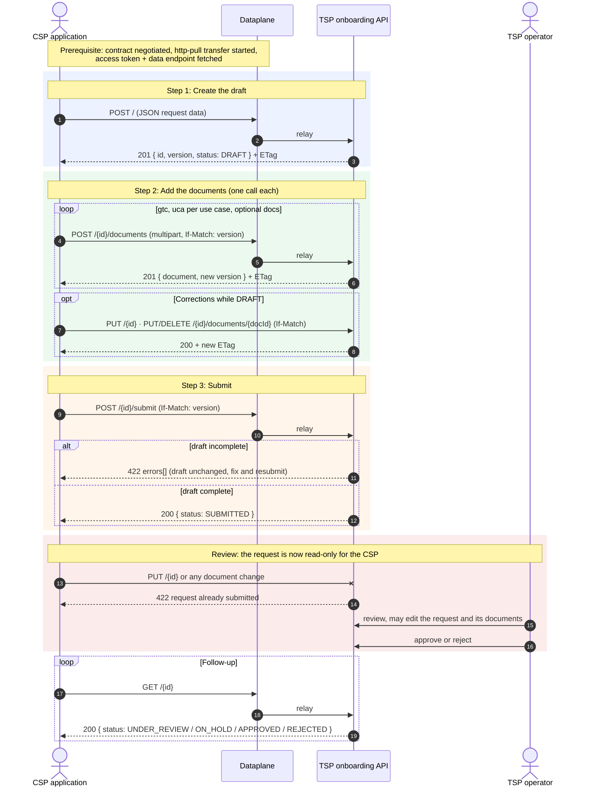

# DECADE-X onboarding API (TSP stand-in)

The VE's stand-in for the DECADE-X TSP's onboarding intake, implementing
[`dataspace-api-docs.yaml`](dataspace-api-docs.yaml): an applicant creates a **draft**, adds its
documents one by one, and **submits** it for review. Once the TSP approves the participant, this
service registers it as a credential holder with the IssuerService and has the issuer offer it the
`DX_LegalEntity_VC` and `DX_Site_VC` — nothing else: the participant's EDC resources (its participant
context on IdentityHub, its control plane, its DID) exist before it onboards.

The API is served under `/api/v1/onboarding-requests` (the spec's `/`), behind a bearer JWT of
the VE's OSP IdP.

## Where the VE deviates from the TSP

- **No gateway.** The Membership Hub calls this service directly instead of through a contract
  and an `http-pull` transfer. The caller's identity — which the spec leaves unsettled — is taken
  from the `X-Connector-Id` header (`dx-onboarding.connector-id-header`), UNVERIFIED; it is the
  participant's DID.
- **No operator.** A submitted request is approved automatically (`dx-onboarding.review`), or
  waits in `SUBMITTED` for a review that does not exist.
- **Hosted participants keep an out-of-band DECADE-X-ID.** The TSP assigns every participant its
  DECADE-X-ID on approval. A participant this VE hosts (a connector identity under
  `dx-onboarding.review.hosted-did-prefix` — in practice the verification participant) is
  deployed before it onboards, with a DECADE-X-ID the hub generated for it, because certo reads
  the id at deployment. For those participants only, `legalEntity.legalEntityId` is honored, so
  the credential carries the id certo was provisioned with. For anybody else it is an unknown
  property: ignored, with a warning.
- **The DID must resolve.** At submit, `legalEntity.preferredDid` must resolve to a DID document
  (`dx-onboarding.did-check`): the credential offer is pushed to the CredentialService it
  advertises.
- **In memory.** Requests and documents are lost on restart; nothing is retained after a draft
  is deleted or purged, so a download never answers `410`.
