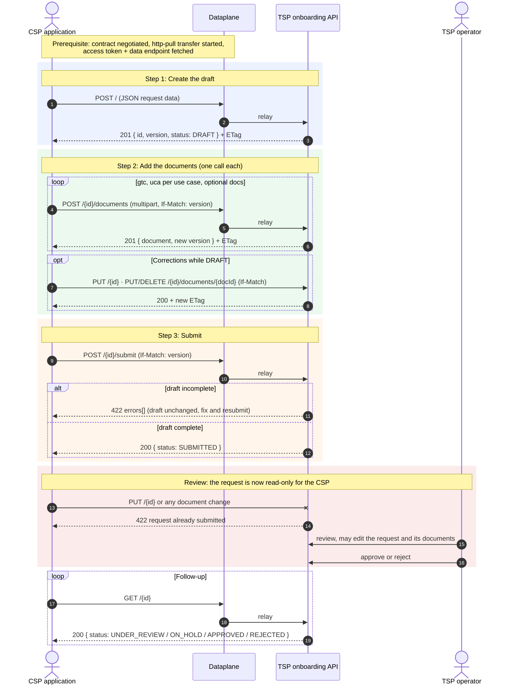

1. Publishing a request: draft → documents → submit
   An onboarding request is always built in three steps:
- Create a draft: POST / with the request data as JSON. The response body contains the request id and its version. The request is now in status DRAFT.
- Add the documents: one POST /{requestId}/documents per document. The signed GTC and one signed use case agreement (UCA) for each entry of ucas are required. The other documents are optional.
- Submit: POST /{requestId}/submit. The TSP checks the whole draft. If anything is missing, the response is 422 and every problem is listed in errors. Otherwise, the request goes to SUBMITTED.

While the request is a draft, you can still correct it (replace data/documents, remove documents, or delete the draft).

2. After submission, the request is read-only for you
   Once a request is submitted, it belongs to the review. You can no longer change it; only the TSP operator can modify the request. If something needs correcting, only the operator can do it.

You can still follow its progress with GET /{requestId} (Statuses: SUBMITTED, UNDER_REVIEW, ON_HOLD, APPROVAL_IN_PROGRESS, APPROVED, REJECTED) and download its documents. Nothing is provisioned until an operator approves the request.

3. Things to know
- Versions: every response carries the request's version (in the body and ETag header). Every change must send it back in If-Match, otherwise the call is refused.
- Retries: Idempotency-Key is optional on create/submit and makes a retry safe.
- DID: the preferredDid must be new to the TSP.

The sequence diagram below sums up the flow:

